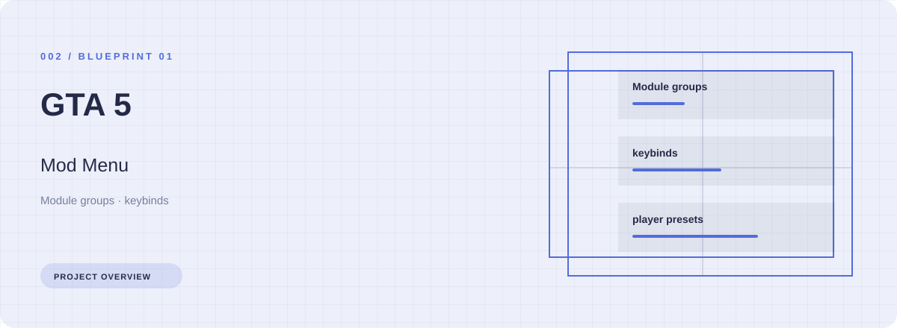
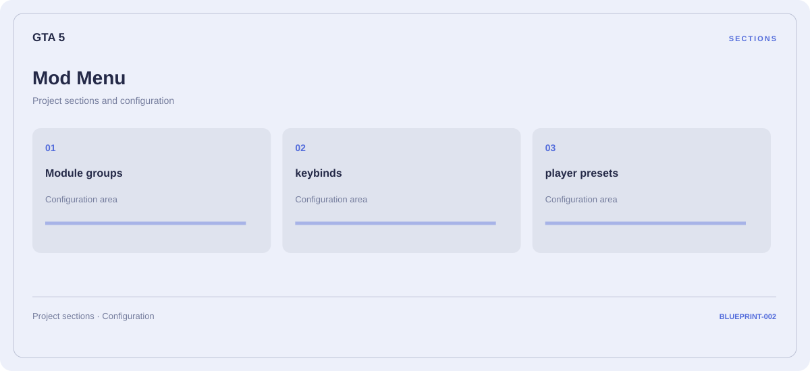

# ⚡ GTA 5 Mod Menu

**Module groups · Keybinds · Player presets**

## ⚡ Features

Use the GTA 5 mod menu workspace to move between module groups, keybinds, and player presets. The section map below gives each part a clear place in the project.

### ⚙️ Module groups

Content and resource groups, together with their configuration or organization details.

### 🧩 Keybinds

Shortcut assignments and control mappings, organized in one reference section.

### ⌨️ Player presets

Related settings collected into named groups for a clearer configuration workflow.

## 🖥️ Project navigation

## 📥 Download

The button and cover open the project's download page. Use the information supplied with the downloaded package for installation and release-specific requirements.

## 📚 Project documentation

- [Feature reference](docs/FEATURES.md)
- [Download information](docs/DOWNLOAD.md)
- [Project page](index.html)

---

GTA 5 Mod Menu · Program documentation and download information.
